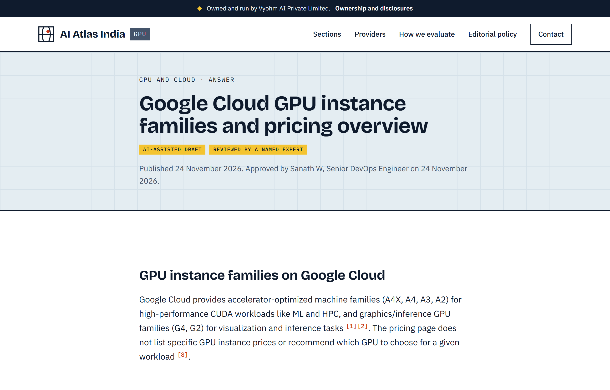
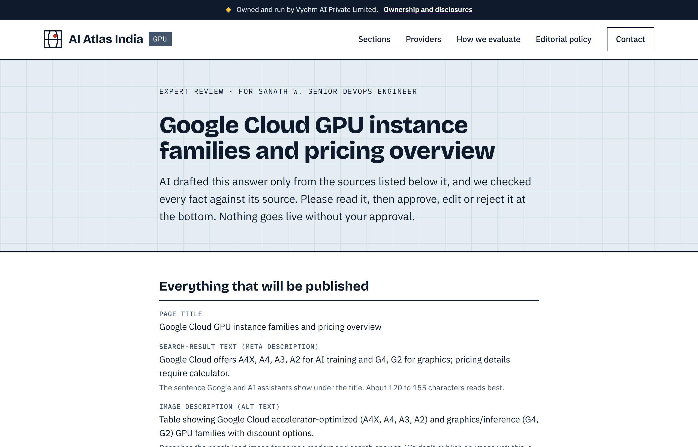
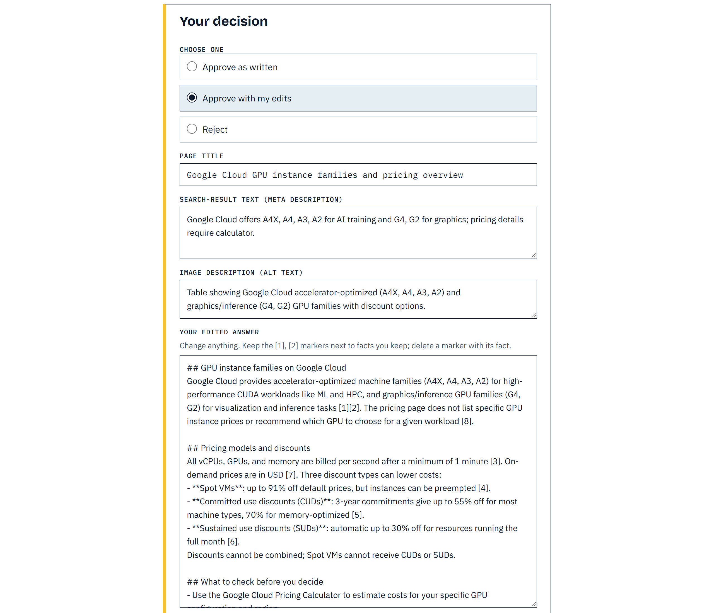

<p align="center">
  
</p>

<h1 align="center">AI Atlas India · GPU Content Engine</h1>

<p align="center">
  <b>AI drafts. A real expert approves. Every fact is sourced and dated.</b><br>
  An AI content engine for the <i>GPU cloud and AI infrastructure</i> section of
  <a href="https://aiatlasindia.com">AI Atlas India</a>, built for <b>Vyohm AI</b>.
</p>

<p align="center">
  <a href="https://gpu.aiatlasindia.com"><b>Live site</b></a> ·
  <a href="docs/expert-guide/AI-Atlas-India-Expert-Reviewer-Guide.pdf">Expert guide (PDF)</a> ·
  <a href="docs/ARCHITECTURE.md">Architecture</a> ·
  <a href="docs/DECISIONS.md">Decisions</a> ·
  <a href="https://bsky.app/profile/watermelon588.bsky.social">Bluesky</a>
</p>

<p align="center">
  
  
  
  
  
</p>

---

## Who this is for

**[Vyohm AI](https://aiatlasindia.com)** runs **AI Atlas India**, an independent guide that helps Indian business owners
choose AI providers. This repo is my entry for Vyohm AI's content-engine assignment: build and run one section of the
site end to end. The section lives at **[gpu.aiatlasindia.com](https://gpu.aiatlasindia.com)** and answers the real
questions people ask before they rent or buy GPU compute in India: cost, which provider, which GPU, and where the data stays.

<p align="center">
  
  <br><sub>A published answer: AI-assisted, approved by a named expert, every fact linked to its source.</sub>
</p>

## How it works

```
collect ─► rank ─► draft ─► check facts ─► expert review ─► publish ─► Bluesky ─► results
 (APIs)    (AI)    (AI)       (admin)      (code-locked)    (≤ 20)    (human-ok)  (AI suggests)
```

| Step | What happens |
|---|---|
| **Collect** | Questions from Stack Exchange and Hacker News through their official APIs, at most 20 new per run. No scraping. |
| **Rank** | The AI scores each one as a buying question, explains why, and merges duplicates. |
| **Draft** | The strongest free models write from whole provider pages. Every fact must quote its source word for word, or the draft is rejected and retried. |
| **Check facts** | The admin opens each source (the link highlights the quote) and ticks the facts. |
| **Expert review** | A one-time link, locked to one expert's personal code. They approve, edit (title, search text, image text, answer) or reject. |
| **Publish** | Only approved answers, hard-capped at 20 in code. Each page names the expert who approved it. |
| **Bluesky** | The AI drafts posts and replies; a person schedules every post and approves every reply. |
| **Results** | AI-crawler and AI-assistant visits, GA4 and Search Console uploads, and AI suggestions for what to write next. |

<p align="center">
  
  
  <br><sub>The expert's review page: everything that will be published, then approve, edit or reject.</sub>
</p>

## Rules enforced in code
- Nothing is published unless an expert approved it; the AI's version and the expert's edits are both kept.
- At most **20** published answers (`api/pages/pages.py`).
- Every fact carries its source link, an exact quote and the date it was checked.
- Bluesky: our own answers only, a person approves every reply, no automated follows, likes or reposts.
- No secrets, expert contact details or commenter data in the repo.

## Stack

| Part | Choice | Folder |
|---|---|---|
| Public pages, admin desk, expert page | Next.js 16 (App Router, TypeScript) on Vercel | [`web/`](web/) |
| AI, jobs, integrations | FastAPI, Python 3.13, on Vercel | [`api/`](api/) |
| Database | Neon Postgres, plain SQL with `psycopg` | [`api/db/schema.sql`](api/db/schema.sql) |
| LLMs | One `llm()` with fallback across Gemini, Groq and OpenRouter free tiers, JSON mode | [`api/core/llm/`](api/core/llm/) |
| Email / Social / Scheduler | Resend / Bluesky / GitHub Actions | [`api/review/`](api/review/), [`api/social/`](api/social/), [`.github/workflows/`](.github/workflows/) |

## Run it locally
```bash
# web: http://localhost:3000
npm --prefix web install && npm --prefix web run dev

# api: http://localhost:8000/health
python -m venv api/.venv
api/.venv/Scripts/python -m pip install -r api/requirements.txt
api/.venv/Scripts/python -m uvicorn main:app --app-dir api --reload --port 8000
```
Copy [`api/.env.example`](api/.env.example) to `api/.env` and [`web/.env.example`](web/.env.example) to `web/.env.local`,
then create the tables: `cd api && .venv/Scripts/python -m db.init_db`. To try the whole flow without touching live
data, use the local test copy described in [`docs/HANDOFF.md`](docs/HANDOFF.md).

**Tests**
```bash
cd api && .venv/Scripts/python -m unittest tests.test_questions tests.test_drafts tests.test_review tests.test_social tests.test_stats -v
cd web && node --test lib/session.test.mjs && npm run lint && npm run build
```

## Documentation

| Doc | What's in it |
|---|---|
| [HANDOFF](docs/HANDOFF.md) | Current state, next steps, and everything that broke and how it was fixed |
| [PROJECT_CONTEXT](docs/PROJECT_CONTEXT.md) | The assignment, its rules and checkpoints |
| [ARCHITECTURE](docs/ARCHITECTURE.md) | How the parts fit together |
| [DECISIONS](docs/DECISIONS.md) | Every design decision and why it was made |
| [GLOSSARY](docs/GLOSSARY.md) | Plain-English definitions of the terms used |
| [Expert guide](docs/expert-guide/) | The PDF guide and onboarding emails for the expert reviewers |
| Prompts | [`rank`](api/questions/prompts/rank.txt), [`draft`](api/drafts/prompts/draft.txt), [`suggest`](api/stats/prompts/suggest.txt) |

## Credits
- **Built by** [Rohit Maity](https://github.com/watermelon588), for Vyohm AI's content-engine assignment.
- **Expert reviewers:** Sanath W (Senior DevOps Engineer) and Prince Patel, who approve every published answer.
- **AI Atlas India** and its design system belong to **Vyohm AI Private Limited**; this section follows their section kit.
- Questions come from the [Stack Exchange API](https://api.stackexchange.com) and the [Hacker News Algolia API](https://hn.algolia.com/api).
- Language models by Google Gemini, Groq and OpenRouter (NVIDIA Nemotron and others) on their free tiers.
- AI coding tools were used while building this; every line was reviewed by the author.

## License
The code is released under the [MIT License](LICENSE). The AI Atlas India name, logo and design system are Vyohm AI's
and are not covered by this license. Published answer text belongs to AI Atlas India.
