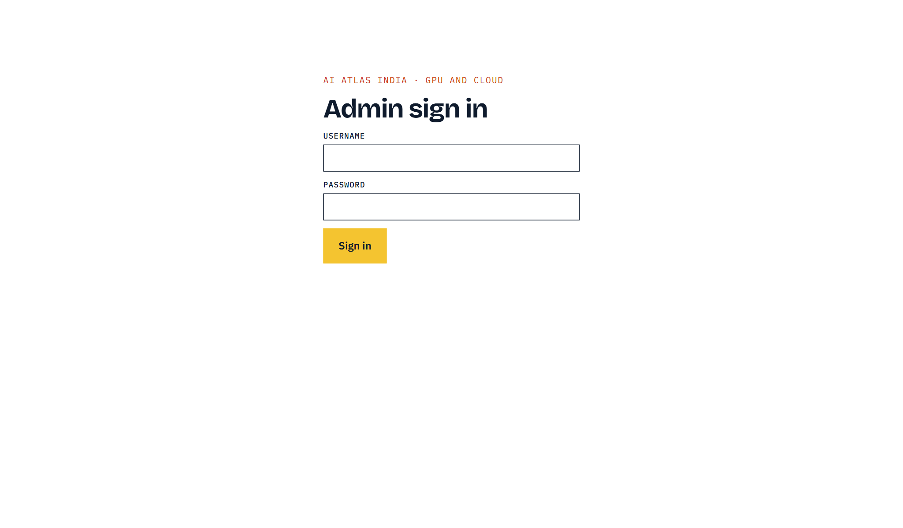
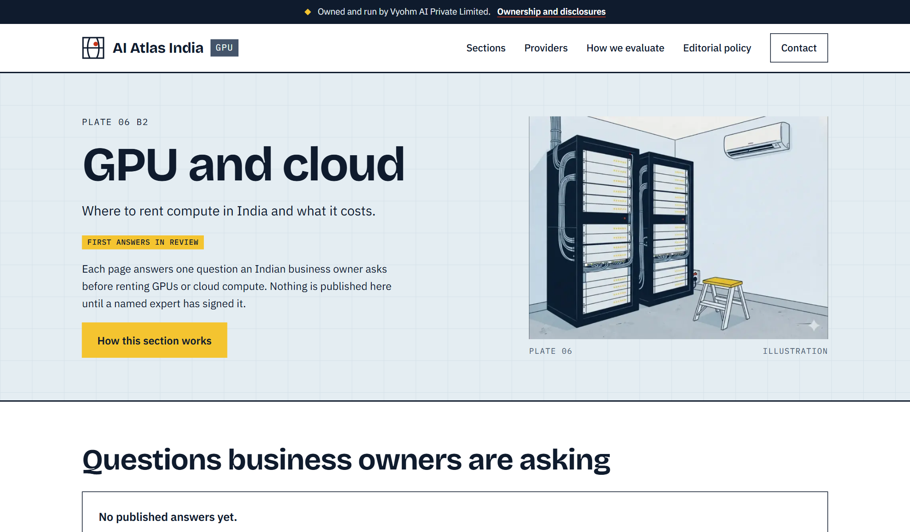
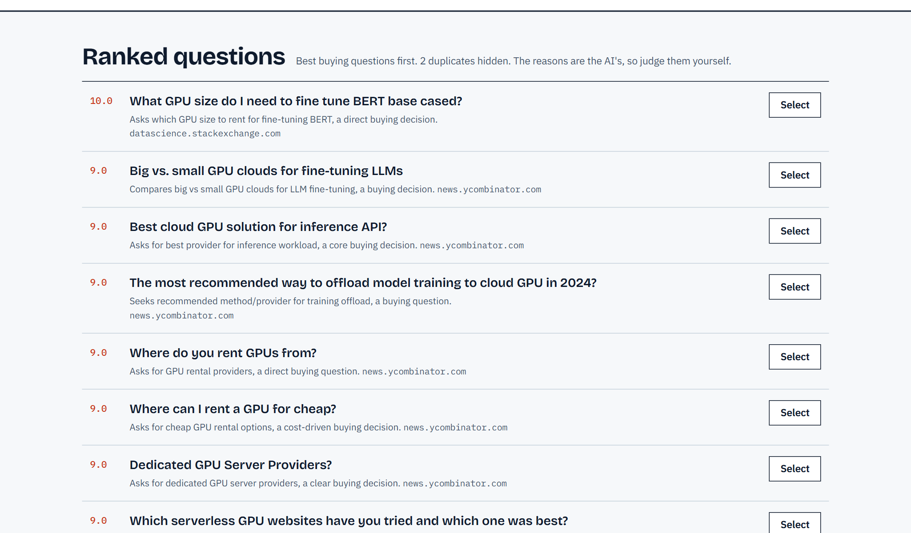
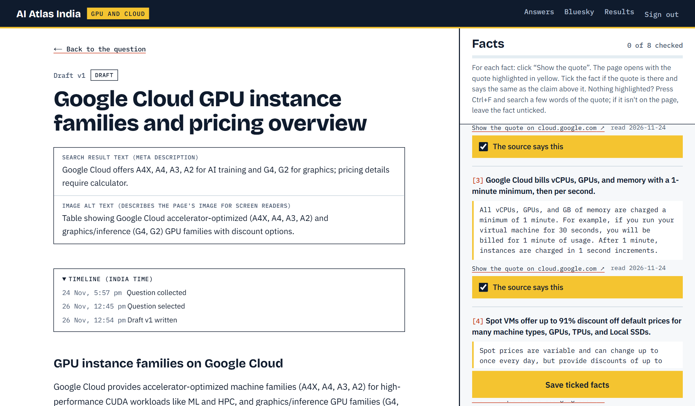
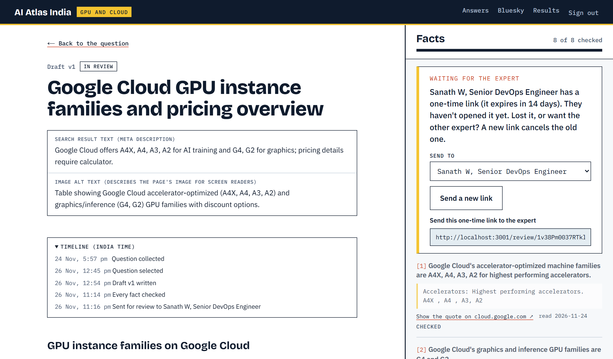
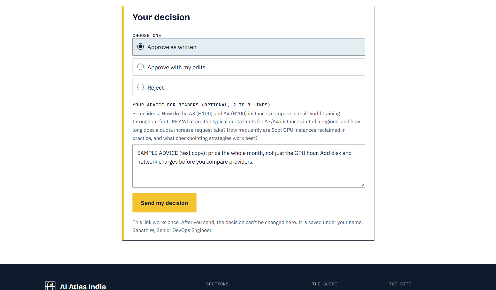
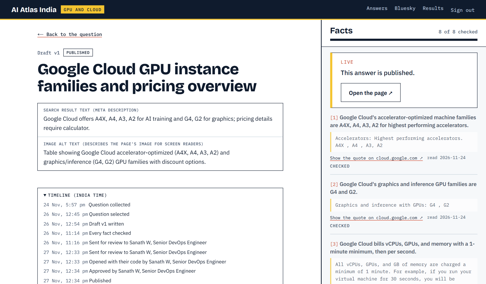
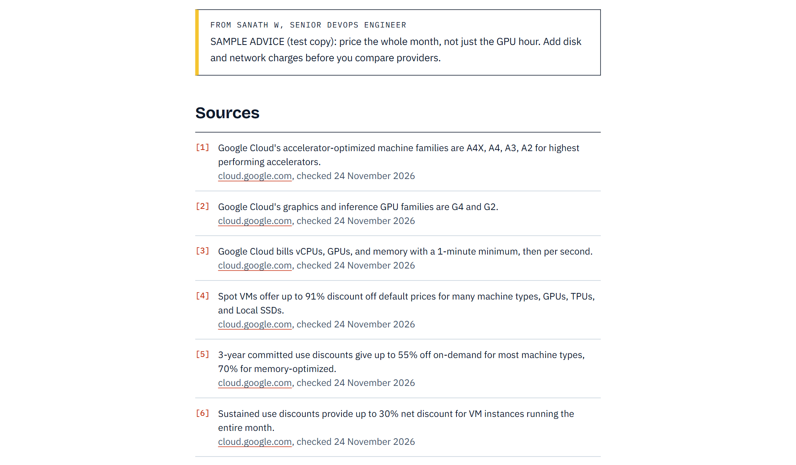
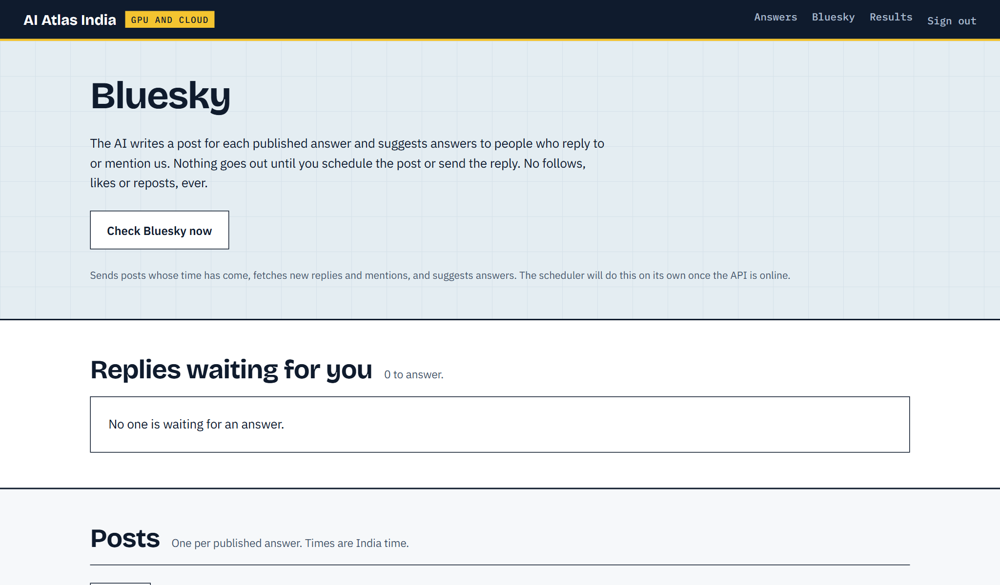

# Demo video walkthrough: Parts 1–4 (question → draft → expert check → published page → Bluesky)

Your script for recording. Each scene has: **Screen** (where you are), **Do** (what to click), **Say** (read it aloud), **You should see** (what to expect), and a screenshot.

## What Vyohm asks for (from the guide)

- **One video, 5 minutes or less**, showing **one answer** going from **question → expert check → published page → social post**.
- It is scored under "Demo and write-up" (10%): *how clearly you explain what you built, what failed and what you would do next.*
- **Nothing private on screen:** no API keys, passwords, your expert's phone number or email, or commenters' names.
- The same file gets uploaded to your LinkedIn post, so keep it tight.

## Time budget for the whole video

| Part | Covers | Time |
|---|---|---|
| **1 (this file)** | Intro, collect, rank, pick, draft | **~1:50** |
| **2 (this file)** | Check facts, send to expert | **~0:45** |
| **3 (this file)** | Expert's decision, publish, public page | **~1:10** |
| **4 (this file)** | Bluesky post, what broke, what's next | **~1:10** |

The plan ends at **4:55**. **It only fits if you use the short lines below.** With the original lines, the whole script is 729 spoken words, about 4:52 of talking at a normal pace, which leaves no time for clicks.

### Short lines for Parts 1–2 (use these)

These replace the **Say** text of five scenes. Nothing else changes.

| Scene | Say this instead |
|---|---|
| 0 | Hi, I'm Rohit. I built a content engine for AI Atlas India's GPU and cloud section. AI drafts the answers, and a real expert approves each one. Here's one, start to finish. |
| 1 | This is my answer desk. The yellow box is always the next step. |
| 3 | The AI scores each question for buying intent, gives a reason, and merges duplicates. I still judge them myself. |
| 6 | Every fact has a source, an exact quote and a date. If a quote isn't on the page, my code removes the fact and the sentences using it. But a real quote may not support the claim, so I check each one. |
| 9 | Now a real expert. The link opens only with their personal code, and nothing publishes without their approval. |

With these, the script is about 3:45 of talking, leaving about 70 seconds for clicks and pauses.

**Already recorded Parts 1–2 with the long lines?** They should end by about **2:40**. If they run longer, re-record those five scenes, or speed the footage up to 1.1x and check that your voice still sounds natural.

Ranking takes 1 to 2 minutes and drafting takes 1 to 4. **Cut those waits in editing** (or pause recording and resume). Never leave a spinner on screen for more than a second or two.

## Before you press record (privacy checklist)

- [ ] **Sign in before recording.** Go to `https://gpu.aiatlasindia.com/login` and sign in, then start recording on `/admin`. That keeps your username and password typing off the video. (If you want to show that the desk is private, show this empty sign-in page for 2 seconds, then cut to the desk.)

  
- [ ] Use a **clean browser window**: one tab, no bookmarks bar, no extensions showing your email or Gmail avatar. Incognito plus sign-in is easiest.
- [ ] **Do not show** VS Code, `.env` files, the API terminal (its error lines name your accounts), Vercel or Neon dashboards, or your Gmail inbox.
- [ ] Zoom the browser to about **110–125%** so text is readable on LinkedIn.
- [ ] The live database is empty right now (checked 26 Nov), so the video starts cleanly from "Collect". Don't run Collect before recording.

> The screenshots below for scenes 3 to 6 come from the **local test copy** of the database, so the question list and the left sidebar will differ from what you see live. The screens, buttons and messages are the same.

---

## Scene 0: Intro (0:00 – 0:15)

**Screen:** Public home page, `https://gpu.aiatlasindia.com/`

**Do:** Nothing. Let the page sit, scroll down a little if you like.

**Say:**
> "Hi, I'm Rohit. For the Vyohm AI assignment I built a content engine for the GPU and cloud section of AI Atlas India.
> The AI finds the questions Indian businesses ask about renting GPUs, and drafts answers. A real expert approves every answer before it goes live, and then it's posted to Bluesky.
> Let me show one answer going all the way through."

**You should see:** The "GPU and cloud" hero, "Owned and run by Vyohm AI" strip on top. "No published answers yet" lower down (until you publish).

---

## Scene 1: Open the answer desk (0:15 – 0:25)

**Screen:** Admin desk, `https://gpu.aiatlasindia.com/admin` (already signed in)

**Do:** Switch to the tab, or type `/admin` in the address bar.

**Say:**
> "This is my private answer desk. These seven boxes are the pipeline: collect, rank, select, draft, check facts, expert review, publish.
> The yellow box is always the one next step. Right now it's step one: collect."

**You should see:** All counters at 0, step 1 **Collect** in yellow, and the yellow button **Collect new questions**.

---

## Scene 2: Collect questions (0:25 – 0:40)

**Screen:** Same desk.

**Do:** Click **Collect new questions**. Wait a few seconds.

**Say:**
> "Collect pulls real questions from the official Stack Exchange and Hacker News APIs. No scraping of Google or Quora, and no Reddit, as the rules say.
> It saves at most 20 new questions per run and skips ones it already has."

**You should see:** A message pops up at the bottom like `stackexchange: 12 new of 40, hackernews: 8 new of 25` (numbers will vary). Box 1 now shows a number of questions, and step 2 **Rank** turns yellow.

---

## Scene 3: Rank them (0:40 – 1:00)

**Screen:** Same desk.

**Do:** Click **Rank unscored**. The button says "Ranking (1 to 2 minutes)…". **Cut the wait.** When it's done, scroll down to **Ranked questions**.

**Say:**
> "Now the AI scores every question from 0 to 10: how likely is it that someone asking this is about to rent GPU compute? It writes a one-line reason for each score and merges duplicates.
> The reasons are the AI's, so I still judge them myself."

**You should see:** A message like `Ranked 20, merged 1 duplicates`. Below, a list sorted best first, each row with a red score, the question, the AI's reason, the site it came from, and a **Select** button.

---

## Scene 4: Pick a question (1:00 – 1:15)

**Screen:** Question page, `/admin?q=<id>` (opens when you click a question's title)

**Do:** Click the **title** of a high-scoring buying question. Best kind: "Where can I rent a GPU cheaply?" or "Which cloud GPU for …". Avoid debugging or driver questions. Then click the yellow **Select this question**.

**Say:**
> "I'll pick this one: '[read the question title]'. It scored [score] because [read the AI's reason].
> The link at the top goes back to where a real person asked it. I select it, and it goes on my shortlist."

**You should see:** Before you click, the badge says **RANKED** with a "Why the AI ranked it" box. After you click, the message says `Added to your shortlist`, the badge changes to **SELECTED**, and the draft form appears.

---

## Scene 5: Draft the answer (1:15 – 1:35)

**Screen:** Same question page, now showing "Tick the provider pages…"

**Do:** Tick **2 provider pages** that fit the question (for example **E2E Networks GPU cloud (prices in rupees)** and **Google Cloud GPU pricing**). Click **Draft the answer**. The button says "Reading the pages and drafting (1 to 4 minutes, keep this tab open)…". **Cut the wait.**

**Say:**
> "Now I choose the sources. The AI may only use these provider pages, nothing from its own memory.
> It downloads the pages, writes the answer, and for every fact it has to copy the exact sentence from the page as proof."

**You should see:** The four provider tick boxes, "Use another page" for any other URL, and the yellow **Draft the answer** button. When it finishes, the page jumps to the draft screen by itself.

> ⚠ **If drafting fails** (a red message like *"the draft was rejected 2 time(s), last reason: …"*): since the 26 Nov fix (D31) this should be rare. A misquoted fact is now dropped with the sentence that used it, instead of failing the whole draft, and the request always ends in time with a message instead of a blank "failed to load". If it still happens, click **Draft the answer** again, or tick fewer pages. Cut the failed attempt, or keep 5 seconds and say: *"Here my code caught the AI misquoting its sources and refused the draft. That's the check working."*
>
> **Tip:** do one practice draft on a different question before recording, so you know how long it takes today.

---

## Scene 6: The draft is ready (1:35 – 1:50)

**Screen:** Draft screen, `/admin?draft=<id>`

**Do:** Scroll the left side slowly: title, search-result text, the answer with its `[1] [2]` markers. Then point at the facts panel on the right. **Don't tick anything yet** (that's Part 2).

**Say:**
> "Here's the draft: a title, the text Google will show, and the answer, with a numbered marker on every fact.
> On the right is every fact with its source link, the exact quote and the date it was checked. If a quote isn't word for word on that page, my code deletes the fact and every sentence that used it, so nothing unsourced survives.
> But a quote existing doesn't prove it supports the sentence, so next I check each fact myself before the expert sees it."

**You should see:** On the left, **Draft v1 · DRAFT**, the title, the search-result text, the image alt text, a **Timeline (India time)** box (question collected → selected → draft written), then the answer. On the right, the **Facts** panel showing "0 of N checked", and for each fact: the claim, the exact quote, "Show the quote on …" with the date read, and a **The source says this** tick box. Below them is the yellow **Save ticked facts** button.

*(This screenshot is a Google Cloud test draft, so your title and facts will match your own question.)*

---

**End of Part 1.**

---

# Part 2: check the facts, send to the expert (1:50 – 2:35)

Picks up on the draft screen where Scene 6 ended. Nothing has been ticked yet.

> The screenshots below come from the local test copy (test draft 8, a Google Cloud draft with 8 facts). Your title and facts will differ; the buttons and messages are the same.

### Extra privacy rules for this part

- [ ] **Don't open your Gmail.** On the live site, "Send" emails the review link to *your* inbox for forwarding. Never show the inbox or the email in the video.
- [ ] **Never show an expert's personal code.** The code isn't on this screen, so just don't type it or paste it anywhere while recording.
- [ ] **The one-time link appears on screen after sending.** It's useless without the expert's code, but don't zoom in on it or leave it on screen for long. Blur it in editing if you can.
- [ ] Showing the expert's **name and title** is fine: it's already on the About page and on every answer they approve. Their email and phone are not.

---

## Scene 7: Check one fact against its source (1:50 – 2:10)

**Screen:** Draft screen, `/admin?draft=<id>`, the **Facts** panel on the right.

**Do:**
1. Point at the hint at the top of the panel.
2. On fact **[1]**, read the claim aloud, then click **Show the quote on cloud.google.com ↗** (the host will match your fact's source).
3. A new tab opens on the provider's page with the quote **highlighted in yellow**. Hold it there for 2 seconds.
4. Go back to the desk tab and tick **The source says this** under fact [1].

**Say:**
> "Before any expert sees it, I check every fact myself. This claim says [read claim 1].
> I click 'Show the quote', and the provider's own page opens with that exact sentence highlighted. It says the same thing, so I tick it."

**You should see:** "0 of N checked" at the top. Each fact has its claim in bold, the quote in a grey box, the link with "read <date>", and a **The source says this** box. After ticking, the box turns yellow.

> **If nothing is highlighted** on the provider's page (some browsers or pages don't support it): press **Ctrl+F** and type a few words of the quote. If it's genuinely not there, leave that fact unticked (see the box after Scene 8).

---

## Scene 8: Tick the rest and save (2:10 – 2:20)

**Screen:** Same Facts panel.

**Do:** **Before recording,** check every other fact the same way. Then, on camera, tick the remaining boxes and click the yellow **Save ticked facts** at the bottom of the panel.

**Say:**
> "I've checked the other facts the same way. I tick them and save.
> Only when every single fact is ticked does the draft move on. One unticked fact and it stays here."

**You should see:** Every box yellow before you save. After saving, a green message: **"Every fact checked. The draft is pre-checked."** The badge at the top changes from **DRAFT** to a yellow **PRECHECKED**, each fact now says **CHECKED**, the counter says "N of N checked", and the timeline gets a new line, **"Every fact checked"**.

> **Honesty note:** don't tick a fact on camera that you haven't actually checked. "I checked the rest off camera" is fine, as long as it's true.
>
> **If a fact is wrong** (the quote isn't on the page, or it doesn't say what the claim says): leave it unticked and click Save. The message says `Saved. 1 fact still to check.` and the draft can't go to the expert. Go **← Back to the question** and click **Draft a new version**, perhaps with different pages. That's a good honest moment to show if it happens.

---

## Scene 9: Send it to the expert (2:20 – 2:35)

**Screen:** Same draft screen. The top of the Facts panel now shows a **NEXT STEP** box.

**Do:** In **Send to**, choose the expert (Sanath W or Prince Patel). Click **Send to the expert**. The button says "Sending…" for a second or two.

**Say:**
> "Now it goes to a real expert. I pick who reviews it. The link only opens with that expert's personal code, so a forwarded email is useless to anyone else, and every decision is recorded under their name.
> Nothing gets published without their approval. My code enforces that, it's not just a promise."

**You should see:** Before clicking, the box says *"Every fact is checked. Choose the expert: the link opens only with their personal code."*

After clicking:
- A green message: **"Review email for Sanath W, Senior DevOps Engineer sent to your inbox. Forward it to them, or copy the link below. It opens only with their code."** (The screenshot shows the wording from the test copy, where email is turned off.)
- The badge changes to **IN REVIEW**.
- The box changes to **WAITING FOR THE EXPERT**: *"… has a one-time link (it expires in 14 days). They haven't opened it yet."*
- Below it: **Send this one-time link to the expert** with the link. Don't linger on it (see the privacy rules).
- The timeline adds **"Sent for review to <expert>"**.

**After you stop recording:** forward the email from your inbox to the expert you chose (off camera). Their personal code was sent to them separately before, so don't send it again in the same email. Part 3 starts after they send their decision.

---

**End of Part 2** (video so far: about 2:35). Record Part 3 only after the expert has answered.

---

# Part 3: expert check → published page (2:35 – 3:45)

**Use the same answer as Parts 1 and 2.** The video has to follow one answer all the way through.

> The screenshots in Parts 3 and 4 come from the local test copy (test draft 8). The advice in them is marked **SAMPLE** because no expert wrote it. Your live screens will show your expert's real words.

### Rules for this part (breaking the first two could disqualify you)

- [ ] **Never open the expert's live review link, and never decide for them.** If you open it with their code, the timeline records that *they* opened it, which would be false. If you approve it, that is a fake expert review.
- [ ] **Publish only after the real expert has approved.** There is no unpublish button.
- [ ] **For the expert's own screen, use the two sample images** (`screens/15-expert-page.png` and `screens/16-expert-decision.png`) as still pictures in your video editor. Put this caption on both: **"Sample from my local test copy. Only the expert opens the real link."** If the expert offers to record their own screen, that is even better: they start *after* the code box, with no email or code visible.
- [ ] The expert must have agreed **in writing** to be named. If Prince reviews, confirm the title and written OK first.
- [ ] Ask the expert to add **2 to 3 lines of their own advice**. It is what a generic AI summary doesn't have, and it appears on the public page. Never write it for them.

---

## Scene 10: What the expert sees (2:35 – 2:55)

**Screen:** Two still images, each with the caption from the rules above.

**Do:** Show `15-expert-page.png` for about 8 seconds, then `16-expert-decision.png`.

**Say:**
> "The expert's link opens only with their personal code. They see everything that will go live, including every fact and its quote.
> Then they approve, edit or reject, and can add advice. These are sample screens from my test copy, because only the expert opens the real link."

---

## Scene 11: The real decision, on the live desk (2:55 – 3:10)

**Screen:** Your real draft, `/admin?draft=<id>` (sign in before recording, then reload the page).

**Do:** Point at the expert's answer box, then at the **Timeline (India time)** box.

**Say** (if approved as written):
> "Back on my desk, this is the real decision: approved. The timeline shows when I sent it, when the expert opened it, and when they decided."

**Say instead** (if approved with edits), and click **Show the AI draft before the expert's edits**:
> "This is the real decision: edited. I keep both the expert's version, which gets published, and the AI's draft from before."

**You should see:** The badge says **APPROVED** or **EDITED**. A box headed with the expert's name and the date shows the decision and their advice. For edits, each changed title or search text has "AI draft: …" under it. The timeline ends with their decision. The right side has a **NEXT STEP** box with a yellow **Publish** button.

> **If they rejected it:** the box says "Rejected" with their reason, and the button is **Write a new version**. Draft again, check the facts and send again. Publish nothing for this question until a version is approved. In the video you can then say: *"The expert rejected my first version, and this is the second."*
>
> An edited answer makes the better demo because it shows before and after. But never ask the expert to edit just for the camera.

---

## Scene 12: Publish (3:10 – 3:20)

**Screen:** Same draft screen.

**Do:** Click **Publish**.

**Say:**
> "Now I publish. The server only accepts answers the expert approved, and it caps the site at twenty."

**You should see:** A message `Published at /q/<address>`. The badge changes to **PUBLISHED**, the box says **LIVE** with **Open the page ↗**, and the timeline adds **Published**.

---

## Scene 13: The public page (3:20 – 3:32)

**Screen:** The live answer, `https://gpu.aiatlasindia.com/q/<address>`

**Do:** Click **Open the page ↗**. Hold on the top of the page.

**Say:**
> "Here's the live page. It says AI drafted it, and names the expert who approved it."

**You should see:** The ownership strip and the **GPU** header, the badges **AI-ASSISTED DRAFT** and **REVIEWED BY A NAMED EXPERT**, then "Published <date>. Approved by <expert> on <date>."

---

## Scene 14: Advice, sources and footer (3:32 – 3:45)

**Screen:** Same public page.

**Do:** Scroll down: the expert's advice box, **Sources**, the "How this page was made" note, then the footer.

**Say:**
> "It carries the expert's advice, every source with the date checked, and who owns the site."

**You should see:** "From <expert>" with their advice (only if they gave some; if not, leave "the expert's advice" out of your line). A numbered source list with "checked <date>". The footer with the ownership line.

**End of Part 3.**

---

# Part 4: post to Bluesky and wrap up (3:45 – 4:55)

### Check these before recording (off camera)

This will be the **first real post** from the engine. Until now, sending was only tested with a fake Bluesky.

- [ ] The Bluesky screen does **not** say "Bluesky isn't connected yet". If it does, add `BLUESKY_HANDLE` and `BLUESKY_APP_PASSWORD` to the Vercel `api` project and redeploy.
- [ ] **The post's card must link to the real site.** The one-time link you got in Scene 9 must start with `https://gpu.aiatlasindia.com/`, because the card uses the same `SITE_URL` setting. If it starts with anything else, fix `SITE_URL` on Vercel and redeploy **before** posting.
- [ ] **See whether the scheduler is on.** On GitHub, open Actions → **jobs** → the newest run. The "Bluesky" step should be green. Grey means skipped: add the `API_URL` and `CRON_SECRET` repository secrets. Vyohm's Level 5 asks for posts to go out on their own, so turn it on.
- [ ] Have your Bluesky profile ready in a **logged-out private window**: https://bsky.app/profile/watermelon588.bsky.social. That keeps your notifications and other accounts off screen. On 27 Nov it showed "AI Atlas India · GPU (automated)", the bot label and 0 posts. The bio starts "it is an automated account…", so change it to "This is an automated account…".

---

## Scene 15: The AI writes the post (3:45 – 4:00)

**Screen:** `/admin?view=social` (click **Bluesky** in the desk's top bar)

**Do:** Scroll to **Posts**. Under your answer, click **Write a post**. **Cut the wait.** Then read the post in the box.

**Say:**
> "The AI writes a Bluesky post from the title, summary and expert's advice. I check it before anything goes out."

**You should see:** A message `Post written. Read it, edit it, then schedule it.` The badge says **DRAFTED**, with the text in a box, an empty **Send at** field, a yellow **Schedule** button and **Write it again**.

> **Read it properly.** If it adds a price, number, provider or claim that isn't in your title, summary or the expert's advice, edit it out or press **Write it again**. If it repeats the expert's advice, check the meaning didn't change.

---

## Scene 16: Schedule and send (4:00 – 4:10)

**Screen:** Same Bluesky screen.

**Do:** Leave **Send at** empty and click **Schedule**. Then scroll to the top, click **Check Bluesky now**, and wait for the message.

**Say** (if the scheduler is on):
> "I schedule it. My scheduler sends due posts; to save time, I'll run it now."

**Say instead** (if it's off):
> "I schedule it, then run the sending job with this button."

**You should see:** First `Scheduled for the next check.` and the badge **SCHEDULED**. After the check: `Sent 1 post, found 0 new replies, suggested 0 answers.` The badge changes to **SENT**, with a **See it on Bluesky ↗** link.

*(The test screenshot shows other dummy answers below yours. There's no screenshot of the SENT state, because the test copy never sends anything.)*

> If the scheduler is on, it may send the post between your two clicks. The message then says `Sent 0 posts`, but the badge already says **SENT**. That's fine.
>
> **If the badge says FAILED:** the error is shown under it. Cut, fix the cause (usually the app password), and click **Schedule** again.

---

## Scene 17: The post on Bluesky, and replies (4:10 – 4:28)

**Screen:** Your profile on bsky.app, in the logged-out private window.

**Do:** Reload. Show the "(automated)" name, the new post and its link card. Click the card so the answer page opens.

**Say:**
> "Here it is, on an account labelled automated, linking to our answer. For replies, the AI suggests a response and I approve each one. The code can't follow, like, repost or send direct messages."

**You should see:** The post, with a card showing your answer's title and search text. The card opens your live page. Its address ends in `?utm_source=bluesky…`, which lets Google Analytics count visits from the post.

> **Don't create a reply for the camera.** No friends and no second account of your own: that counts as faked engagement. If a real person has replied and you show the **Replies waiting for you** box, **blur their text and the "Open on Bluesky" link**.

---

## Scene 18: What broke and what's next (4:28 – 4:55)

**Screen:** The desk's **Results** screen, `/admin?view=results`.

**Do:** Click **Results** in the top bar. Scroll gently while you talk.

**Say:**
> "This screen tracks AI traffic and posts.
> What broke? One misquoted fact rejected the whole draft, and retries hit my host's five-minute limit. Now only that fact and its sentences are dropped.
> My code proves a quote exists, not that it supports the claim, so people check that.
> Next, I'd pick questions from real search data. Thank you."

**You should see:** The counter tiles, what to answer next, AI traffic, Bluesky post counts and the CSV upload. Small or zero numbers are expected, so don't present them as results.

> Look at this screen off camera first. If anything personal is showing, such as an uploaded file's name, crop it out.

**End of the video (about 4:55).**

---

## After recording: final checks before you upload

- [ ] **The video is 5:00 or less**, with the ranking, drafting and post-writing waits cut.
- [ ] **Watch it once, pausing on every screen.** Look for API keys, passwords, expert codes, the expert's email or phone, your Gmail avatar or inbox, Vercel or Neon screens, and any commenter's name.
- [ ] The one-time link in Scene 9 is blurred.
- [ ] Both sample images in Scene 10 carry the "Sample from my local test copy" caption.
- [ ] Upload to **YouTube or X**, or send it with the submission (HR waived the LinkedIn post, so quote that in your submission email).
- [ ] Open the link in a private window to make sure it plays without signing in.
- [ ] Off camera: in Search Console, request indexing for the new answer's address.
- [ ] The **one-page write-up** is separate. It needs how the engine works, the LLM prompts (the `.txt` files in the `api/*/prompts/` folders), how you checked the AI's output, what broke, and a line saying AI coding tools were used to build it.
