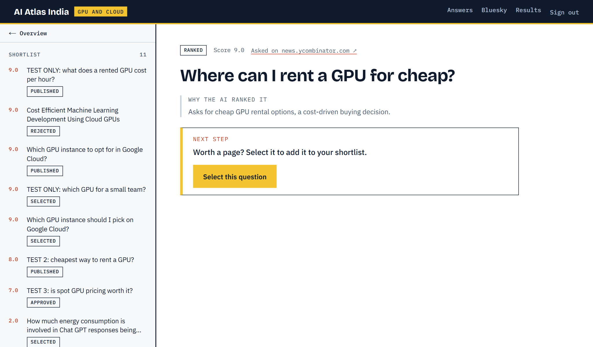
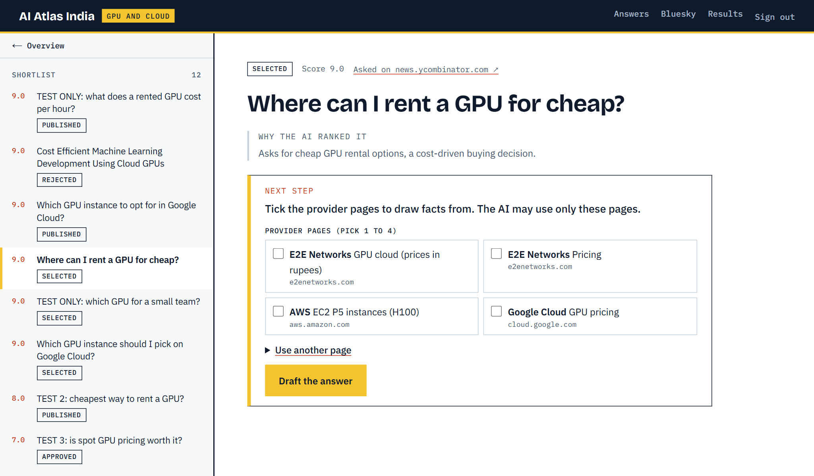
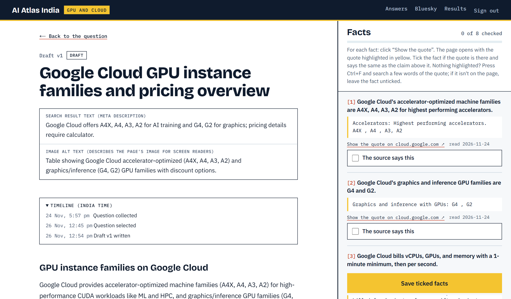
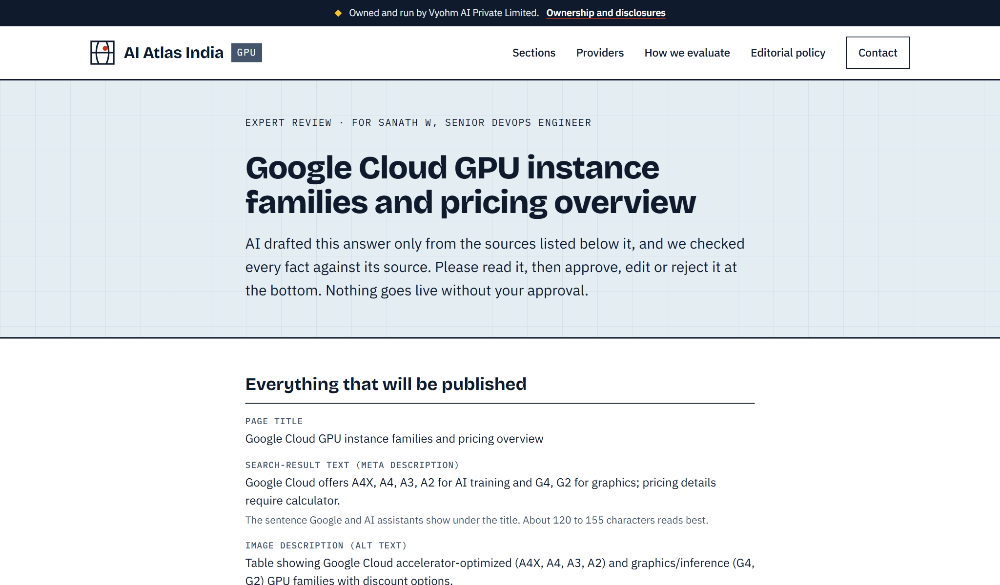
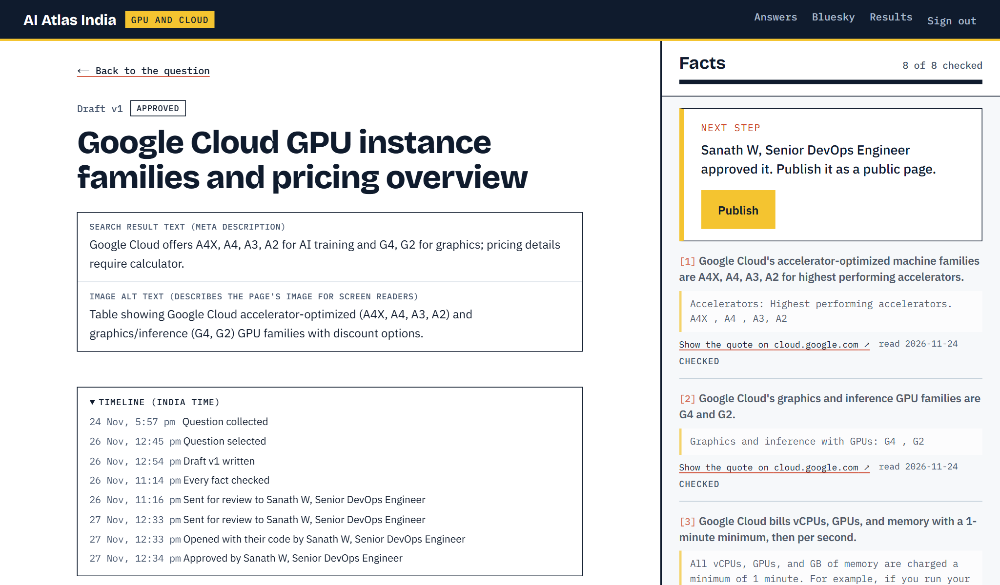
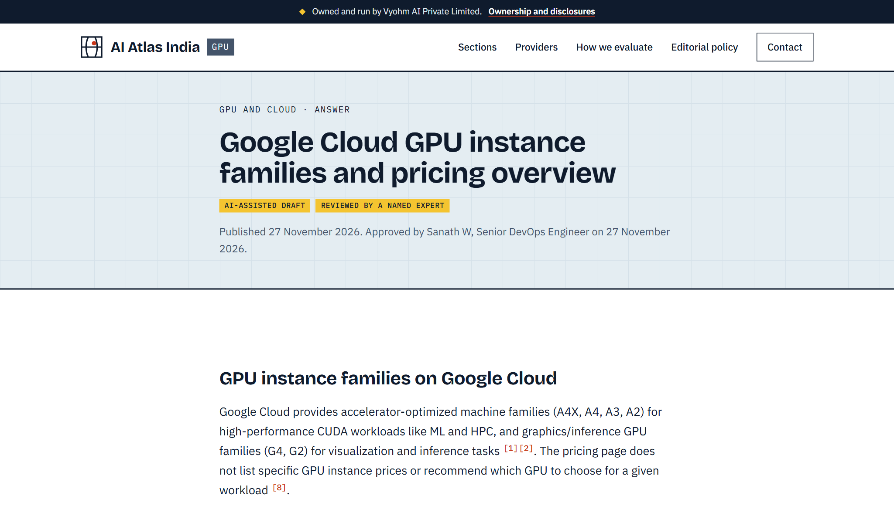
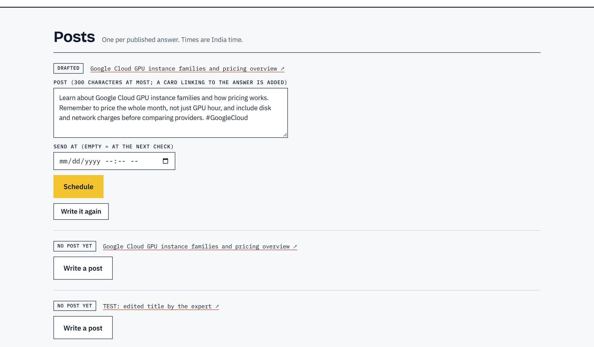
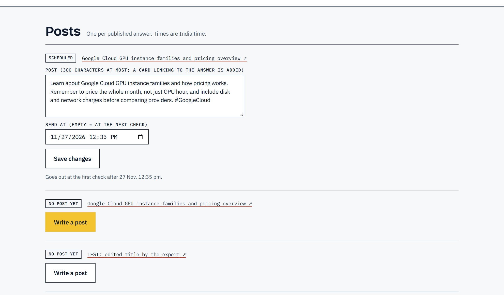

# Demo video script

One answer, start to finish: question → draft → fact check → expert → published page → Bluesky. **5 minutes max.**
Each scene: what's on screen, what you click, and the line to say. Cut every wait (ranking, drafting, the 30-minute schedule).

## Before recording (off camera)

- [ ] Sign in at `https://gpu.aiatlasindia.com/login` first. Start recording on `/admin`.
- [ ] Clean browser window: one tab, no bookmarks bar, no Gmail avatar. Zoom 110–125%.
- [ ] Never show: VS Code, `.env`, terminals, Vercel/Neon dashboards, Gmail, expert codes, expert email or phone, commenters' names.
- [ ] **Never open the expert's live review link.** Use the two sample stills (`15`, `16`) for the expert's screen, captioned *"Sample from my local test copy."*
- [ ] Bluesky: the Bluesky screen doesn't say "not connected", and the GitHub Actions `jobs` run has a green **Bluesky** step.
- [ ] Open the Bluesky profile in a logged-out private window: https://bsky.app/profile/watermelon588.bsky.social

---

## Part 1: find the question and draft the answer

### 0. Intro
**Screen:** home page `https://gpu.aiatlasindia.com/`
> "Hi, I'm Rohit. This is the GPU and cloud section of AI Atlas India. AI drafts the answers, a real expert approves each one. Here's one, start to finish."

### 1. The desk
**Screen:** `/admin`
> "This is my private desk. The yellow box is always the next step."

### 2. Collect
**Do:** click **Collect new questions**.
> "Collect pulls real questions from the Stack Exchange and Hacker News APIs."

### 3. Rank
**Do:** click **Rank unscored**, cut the wait, scroll to **Ranked questions**.
> "The AI scores each one for buying intent and gives a reason."

### 4. Pick one
**Do:** click a buying question's title, then **Select this question**.
> "I'll take this one. Selected."

### 5. Draft
**Do:** tick 2–3 provider pages, click **Draft the answer**, cut the wait.
> "I pick the provider pages. The AI may only use these."

### 6. The draft
**Do:** scroll the draft, point at the facts panel.
> "Here's the draft. Every fact has a source, an exact quote and a date."

---

## Part 2: check facts, send to the expert

### 7. Check a fact
**Do:** click **Show the quote on …** on fact 1, hold on the highlighted quote, come back, tick it.
> "I check each fact. The provider's page opens with the quote highlighted. It matches, so I tick it."

### 8. Save
**Do:** tick the rest (checked off camera), click **Save ticked facts**.
> "All facts checked. Now it can go to the expert."

### 9. Send
**Do:** choose the expert, click **Send to the expert**. Don't linger on the link (blur it).
> "I send it to the expert. Their link only opens with their personal code."

---

## Part 3: expert decision and publish

Record this only after the real expert has answered.

### 10. The expert's screen (sample stills)
**Screen:** `15-expert-page.png`, then `16-expert-decision.png`, with the caption.
> "The expert sees the answer and every source, then approves, edits or rejects. These are samples from my test copy."

### 11. The decision
**Screen:** your draft on `/admin?draft=<id>`, reloaded.
> "Here's the real decision: approved." *(or "edited", and click "Show the AI draft" to show before and after)*

### 12. Publish
**Do:** click **Publish**.
> "I publish it. Only approved answers can go live."

### 13. The public page
**Do:** click **Open the page ↗**, scroll to the advice and sources.
> "Here's the live page: who approved it, their advice, and every source with its date."

---

## Part 4: Bluesky

### 14. AI writes the post
**Screen:** **Bluesky** in the desk's top bar (`/admin?view=social`). **Do:** click **Write a post** under the answer.
> "This is the Bluesky screen. The AI writes a short post for the answer. I read it before it goes out."

### 15. Schedule it
**Do:** set **Send at** to 30 minutes from now, click **Schedule**.
> "I schedule it for 30 minutes from now. A GitHub Action runs every 30 minutes and sends whatever is due."

**Pause recording.** Wait for the next scheduled run after that time (GitHub can be a few minutes late). If it's very late, use Actions → **jobs** → **Run workflow**.

### 16. The scheduler ran
**Screen:** GitHub → Actions → **jobs** → the newest run, with the green **Bluesky** step.
> "Here's the scheduled run. It sent the post."

### 17. The post on Bluesky
**Screen:** the private window with the Bluesky profile, reloaded.
> "And here's the post, on an account labelled automated. The card links back to our answer."

### 18. Back on the site
**Screen:** the home page.
> "The home page now links each answer to its Bluesky post."

### 19. Replies
**Screen:** the Bluesky screen's replies box (blur the person's text), or just stay on the post.
> "When someone replies, the AI suggests an answer and I approve each one. It never follows, likes or DMs."

---

## Wrap-up

### 20. What broke, what's next
**Screen:** **Results** in the top bar.
> "This screen tracks AI traffic and posts. What broke: one misquoted fact used to reject the whole draft. Now only that fact is dropped. Next, I'd pick questions from real search data. Thanks."

---

## After recording

- [ ] Under 5:00, waits cut.
- [ ] Watch it once, pausing on every screen, for anything private.
- [ ] The one-time link (scene 9) is blurred; the sample stills (scene 10) have the caption.
- [ ] Upload, and check it plays in a private window.
